

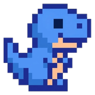

# DinoStart

**Ton nouvel onglet Chrome, 100 % à ta façon.**
Favoris rangés en dossiers, projets, notes, tâches, recherche façon Google, thèmes et cartes que tu déplaces où tu veux.
Et tout ça se **synchronise entre tous tes ordinateurs** grâce à un dépôt GitHub privé.

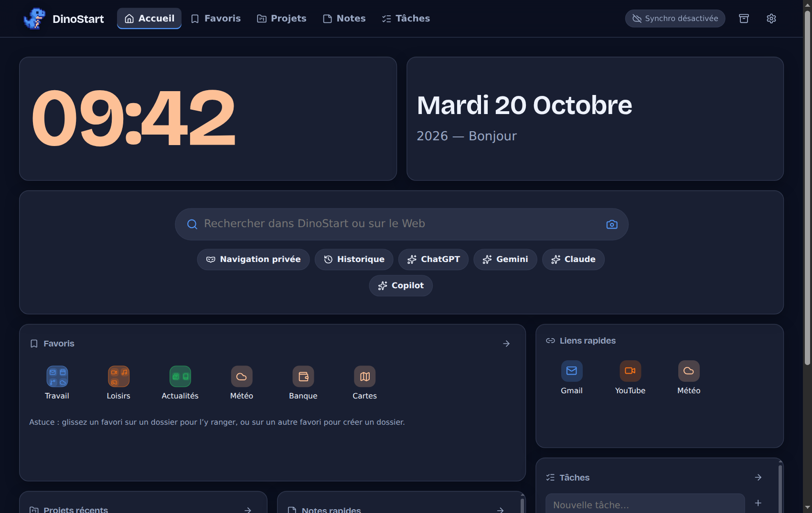

**Gratuit · Aucun compte à créer chez nous · Aucune pub · Aucune collecte de données**

[Installer](#2-installer-dinostart) · [Visite guidée](#3-visite-guidée) · [Synchroniser plusieurs PC](#4-synchroniser-plusieurs-ordinateurs) · [Dépannage](#6-dépannage) · [Discord](#8-un-bug-une-idée-une-question-)

---

## Sommaire

1. [C'est quoi DinoStart ?](#1-cest-quoi-dinostart-)
2. [Installer DinoStart](#2-installer-dinostart)
3. [Visite guidée](#3-visite-guidée)
4. [Synchroniser plusieurs ordinateurs](#4-synchroniser-plusieurs-ordinateurs)
5. [Sauvegarder et restaurer tes données](#5-sauvegarder-et-restaurer-tes-données)
6. [Dépannage](#6-dépannage)
7. [Vie privée et sécurité](#7-vie-privée-et-sécurité)
8. [Un bug, une idée, une question ?](#8-un-bug-une-idée-une-question-)

---

## 1. C'est quoi DinoStart ?

DinoStart remplace la page qui s'ouvre quand tu ouvres un **nouvel onglet** dans Google Chrome (le bouton « + » en haut de la page).
À la place de la page vide de Chrome, tu retrouves **ton** tableau de bord :

| Tu veux… | DinoStart te donne… |
|---|---|
| Ouvrir tes sites en un clic | Des **favoris** avec leur icône, rangés en **dossiers** comme sur un téléphone |
| Chercher vite | Une barre de recherche **façon Google** : suggestions, recherches récentes, Google Lens, navigation privée, raccourcis vers ChatGPT, Gemini, Claude… |
| Rester organisé | Des **projets**, des **notes** (enregistrées toutes seules) et des **tâches** avec échéances |
| Que ce soit joli et à toi | Des cartes que tu **déplaces et redimensionnes** à la souris, des couleurs, un thème clair ou sombre |
| Retrouver tout ça partout | Une **synchronisation entre plusieurs PC** via GitHub (gratuit, facultatif) |

> [!NOTE]
> DinoStart fonctionne **sans Internet** : tout est enregistré sur ton ordinateur. La synchronisation est facultative.
> C'est une extension pour **Google Chrome sur ordinateur** (Windows, Mac, Linux).

---

## 2. Installer DinoStart

Pas besoin d'installer de logiciel ni de taper de commandes. Compte environ **3 minutes**.

### Étape 1 — Télécharger

1. Sur la page GitHub de DinoStart, clique sur le bouton vert **« Code »**, puis sur **« Download ZIP »**.
   (Si une page « Releases » propose un fichier `dinostart.zip`, tu peux aussi le prendre là.)
2. Va dans ton dossier **Téléchargements**, fais un **clic droit** sur le fichier `.zip` puis **« Extraire tout… »**.
3. Place le dossier obtenu à un endroit où il restera, par exemple `C:\DinoStart\`.
4. Garde uniquement le dossier **`dist`** : c’est celui qu’on donne à Chrome pour installer l’extension. Tu peux supprimer le reste des fichiers, sauf si tu souhaites modifier l’extension plus tard.

> [!IMPORTANT]
> **Ne déplace pas et ne supprime pas ce dossier** après l'installation : Chrome lit DinoStart directement depuis lui.
> Si tu le déplaces, Chrome le considère comme une *nouvelle* extension et **tes données ne suivent pas** (elles restent attachées à l'ancien emplacement).

### Étape 2 — Dire à Chrome de le charger

1. Dans Chrome, tape `chrome://extensions` dans la barre d'adresse, puis `Entrée`.
2. En haut à droite, active le **« Mode développeur »** (repère **1**).
3. Clique sur **« Charger l'extension non empaquetée »** (repère **2**).
4. Choisis le dossier **`dist`**, puis **« Sélectionner le dossier »**.
5. DinoStart apparaît dans la liste (repère **3**), avec son petit dino.

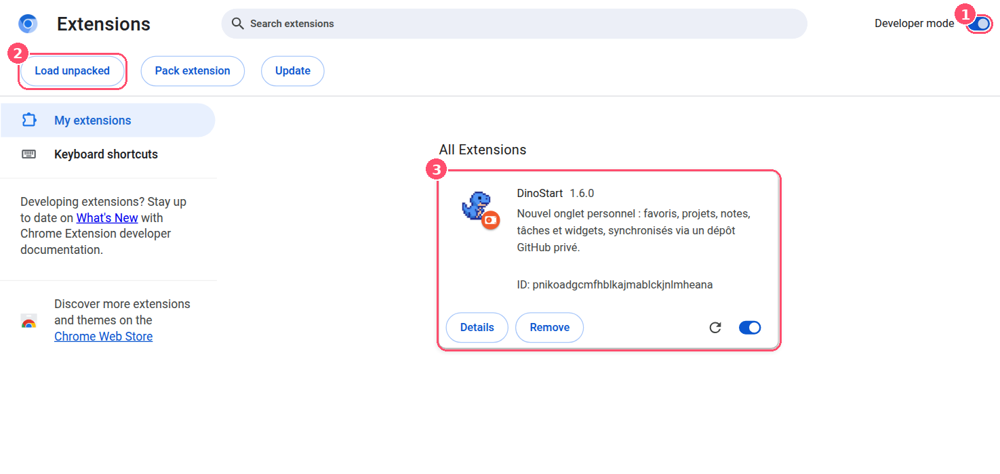

Capture réalisée sur un Chrome en anglais : chez toi, « Developer mode » s'appelle « Mode développeur » et « Load unpacked » s'appelle « Charger l'extension non empaquetée ».

### Étape 3 — Ouvrir un nouvel onglet

Clique sur le **« + »** : DinoStart s'affiche. Au tout premier lancement, un **assistant** te pose quelques questions rapides (moteur de recherche, apparence). Tu peux le passer et tout régler plus tard.

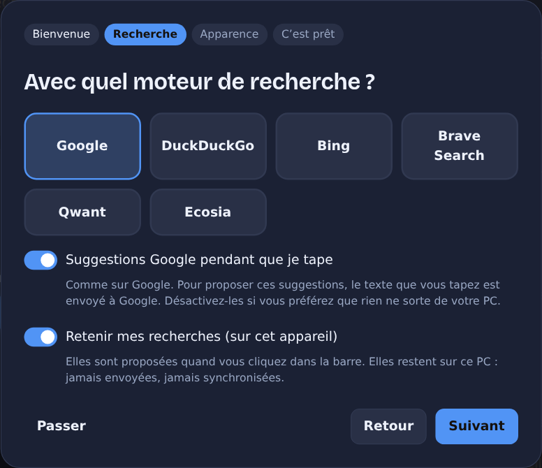

> [!TIP]
> **Une barre apparaît en bas de l'écran avec « DinoStart » et « Personnaliser Chrome » ?**
> Elle vient de **Chrome**, pas de DinoStart : Chrome l'affiche sous toutes les extensions qui remplacent le nouvel onglet.
> **Fais un clic droit dessus et désactive-la.** (L'intitulé exact du choix dépend de ta version de Chrome.)
> Si elle revient un jour, par exemple après une mise à jour de Chrome, refais la même chose.

> [!NOTE]
> Au démarrage de Chrome, il se peut qu'un message te parle des « extensions en mode développeur ». C'est normal pour une extension installée comme ceci : **garde-la activée**.

### Mettre à jour DinoStart

1. Télécharge la nouvelle version (étape 1) et **remplace le contenu** de ton ancien dossier par le nouveau (garde le même emplacement).
2. Va sur `chrome://extensions` et clique sur la flèche circulaire **« Actualiser »** de la carte DinoStart.
3. Tes données sont conservées, et converties automatiquement si le format a changé.

> Si tu synchronises plusieurs PC, **mets-les tous à jour** : une ancienne version refuse de lire des données plus récentes (avec un message clair) plutôt que de les abîmer.

---

## 3. Visite guidée

### La page d'accueil

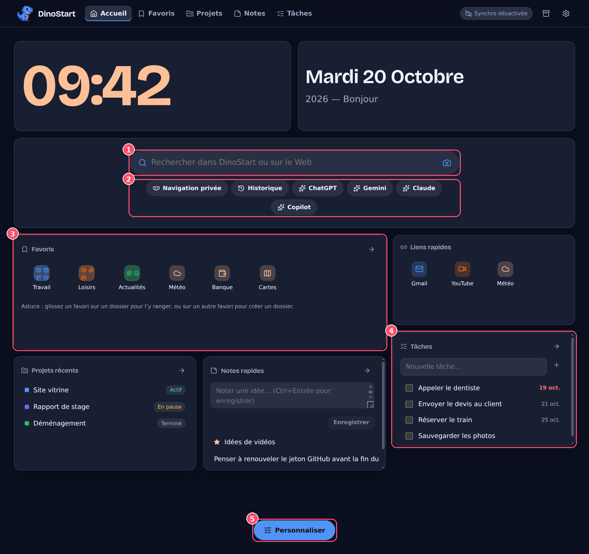

| # | Ce que c'est |
|---|---|
| **1** | La **barre de recherche** : cherche dans tes favoris, projets, notes et tâches, **et** sur le Web. |
| **2** | Les **raccourcis** : navigation privée, historique, assistants IA… que **tu peux changer**. |
| **3** | Tes **favoris**, rangés en **dossiers** (clique sur un dossier pour l'ouvrir). |
| **4** | Les autres **cartes** : tâches, projets récents, notes rapides, liens rapides, horloge, date… |
| **5** | Le bouton **Personnaliser**, tout en bas de la page. |

En haut : **Accueil · Favoris · Projets · Notes · Tâches**. À droite : l'état de la **synchronisation**, les **Sauvegardes** (icône boîte) et les **Paramètres** (roue).

### La recherche

<table>
<tr>
<td width="50%">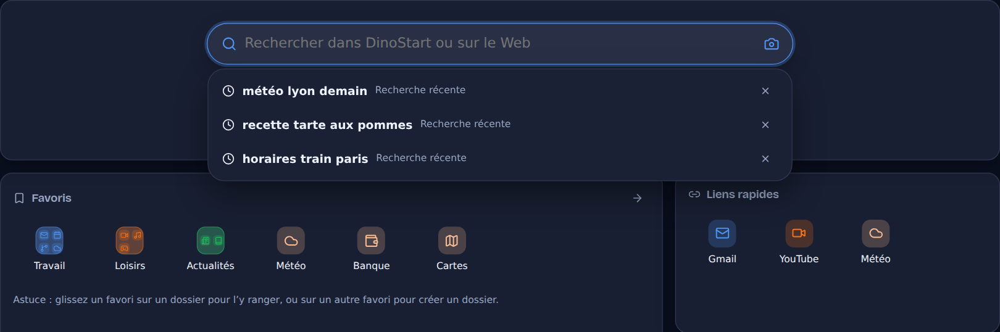 <b>Clic dans la barre vide</b> : tes recherches récentes (la croix en oublie une).</td>
<td width="50%">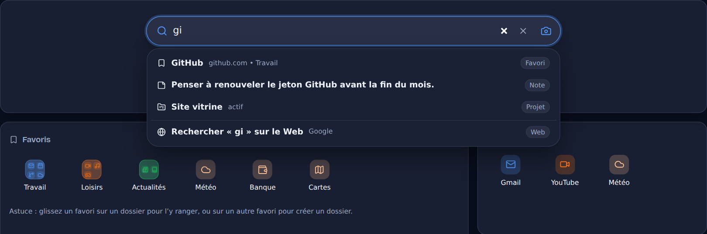 <b>En tapant</b> : tes favoris, notes, projets, tâches… puis la recherche sur le Web.</td>
</tr>
</table>

- **Entrée** : lance la recherche sur le Web avec ton moteur (Google par défaut). **↓** puis **Entrée** : ouvre la ligne choisie.
- **Ctrl + Entrée** : ouvre le résultat dans un **nouvel onglet**. **Touche `/`** : place le curseur dans la barre depuis n'importe où.
- **Suggestions Google** pendant que tu tapes (comme sur Google).
  > [!NOTE]
  > Pour proposer ces suggestions, le texte que tu tapes est envoyé à Google. Tu peux les désactiver dans **Paramètres → Recherche** : plus rien ne sort alors de ton PC pendant la frappe.
- **L'icône appareil photo** ouvre **Google Lens** (recherche par image).
- **Tes recherches passées** sont gardées **sur ton ordinateur uniquement** (jamais synchronisées) et s'effacent d'un clic dans les paramètres.
- Les recherches faites en **navigation privée** ne sont jamais enregistrées.

### Favoris et dossiers

Va dans **Favoris** pour **ajouter** un site : titre, adresse (tu peux écrire juste `youtube.com`), catégorie. **L'icône du site est mise automatiquement** par Chrome. Tu peux aussi choisir une lettre ou l'une des 18 icônes.

> [!NOTE]
> Chrome ne connaît l'icône que des sites que tu as **déjà visités**. Pour les autres, un petit globe s'affiche : choisis alors une icône dans la fiche du favori.

Sur l'accueil, tes catégories sont des **dossiers, comme sur un téléphone** :

- **Clique** sur un dossier pour voir son contenu (ci-dessous). **Modifier le dossier** : renommer, changer la couleur, retirer un favori, supprimer le dossier (ses favoris ne sont jamais supprimés).
- **Glisse un favori sur un dossier** pour l'y ranger.
- **Glisse un favori sur un autre favori** : un nouveau dossier est créé avec les deux.
- L'**étoile** d'un favori l'ajoute à la carte **Liens rapides**.

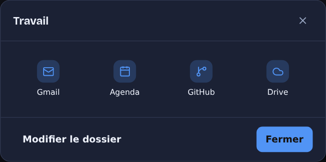

### Personnaliser : déplacer et redimensionner les cartes

Clique sur **Personnaliser** (tout en bas de la page). Chaque carte reçoit une barre et une poignée :

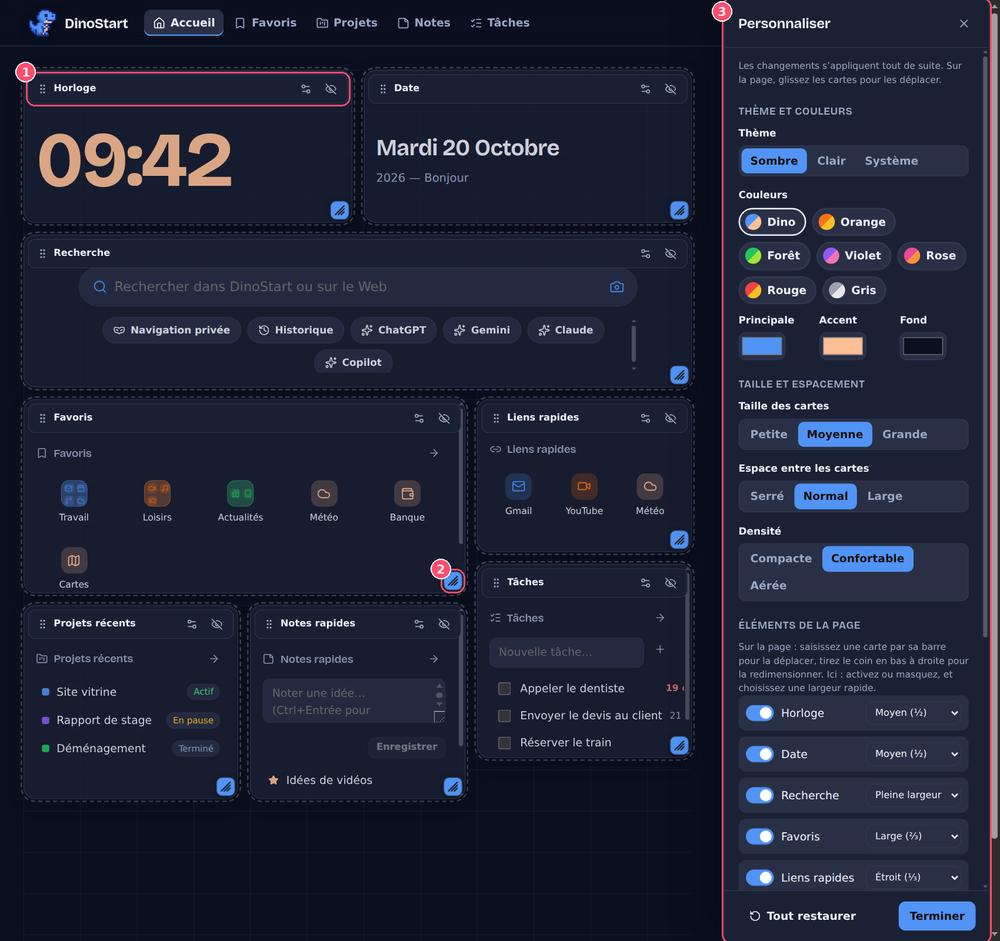

| # | Comment faire |
|---|---|
| **1** | **Déplacer** : attrape une carte par sa **barre** et glisse-la où tu veux. Les cartes gênées se poussent automatiquement, **elles ne se superposent jamais**. |
| **2** | **Redimensionner** : tire le **petit carré en bas à droite** de la carte. |
| **3** | Le **panneau** : thème clair/sombre, **palettes de couleurs** (Dino, Orange, Forêt, Violet…), taille des cartes, espace entre les cartes, densité, activer ou masquer chaque carte, **« Tout restaurer »**. |

Les barres de chaque carte ont aussi un bouton **réglages** (nombre d'éléments affichés, etc.) et un bouton **masquer**. Quand tu as fini, clique sur **Terminer**.
Si une carte est réduite, son contenu **reste dans son cadre** (il défile à l'intérieur si besoin). Au clavier : flèches pour déplacer, `Maj` + flèches pour redimensionner.

### Les raccourcis sous la recherche

Navigation privée, historique, ChatGPT, Gemini… **tout est modifiable** : **Paramètres → Recherche → Raccourcis**, ou **Personnaliser → « Gérer les boutons »**.

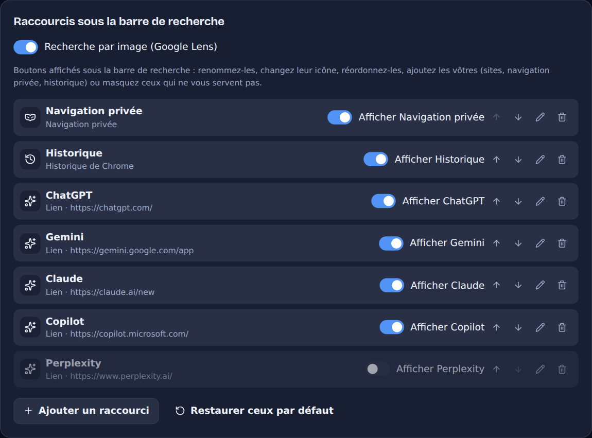

Tu peux **renommer**, **changer l'icône** (36 au choix, ou l'icône du site), **réordonner** avec les flèches, **masquer** avec l'interrupteur, **supprimer**, ou **ajouter les tiens**. Trois types :

- **Lien** vers un site (avec, si le site le permet, ta question envoyée directement : adresse avec `{query}`, par exemple `https://exemple.fr/?q={query}`) ;
- **Navigation privée** : sur ta recherche, ou sur **une adresse précise** de ton choix (utile pour ouvrir ta banque en privé) ;
- **Historique** de Chrome.

### Projets, notes et tâches

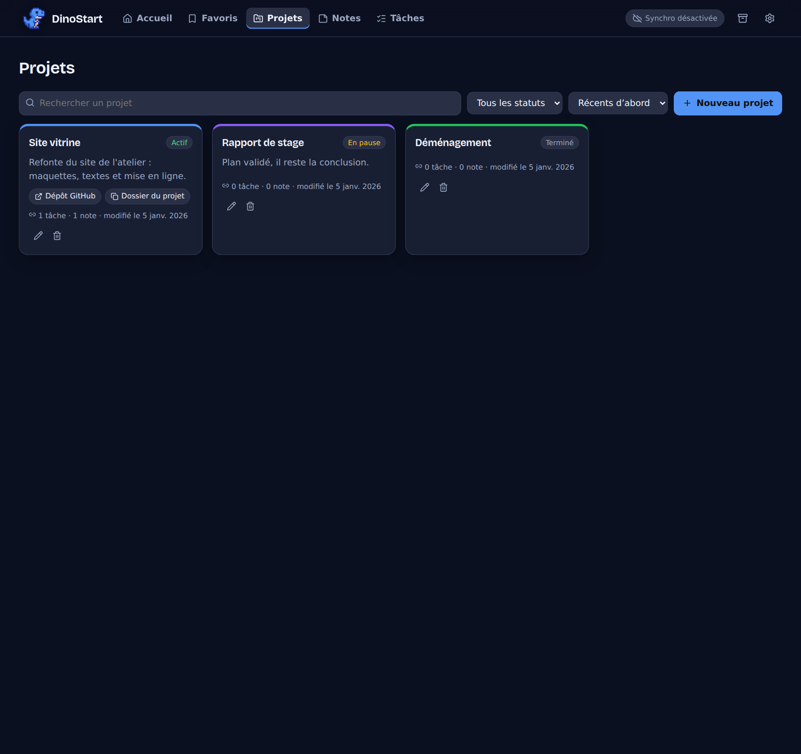

- **Projets** : statut (actif, en pause, terminé), couleur, **liens** (sites) et **chemins** de dossiers (à copier : DinoStart n'ouvre pas tes dossiers), avec leurs notes et tâches.
- **Notes** : **enregistrées toutes seules** pendant que tu écris, étoile, lien avec un projet.
- **Tâches** : échéance (en **rouge** quand elle est dépassée), projet, filtres *à faire / en retard / terminées*.

### Couleurs et thèmes

Thème **sombre, clair ou système**, palettes toutes faites (la palette **Dino** reprend les couleurs du logo), couleurs **principale, accent et fond** au choix, **image de fond** de ton ordinateur, opacité des cartes. L'horloge s'éclaircit ou s'assombrit toute seule pour rester lisible.

---

## 4. Synchroniser plusieurs ordinateurs

> [!NOTE]
> **Facultatif.** Si tu n'utilises DinoStart que sur un seul PC, tu peux sauter cette partie.

### Comment ça marche, en simple

Imagine un **coffre partagé sur Internet** (un « dépôt » GitHub privé). Chaque ordinateur garde **sa propre copie** de DinoStart et la **met à jour avec le coffre** de temps en temps. Tu ajoutes un favori sur le PC 1 → il apparaît sur le PC 2.

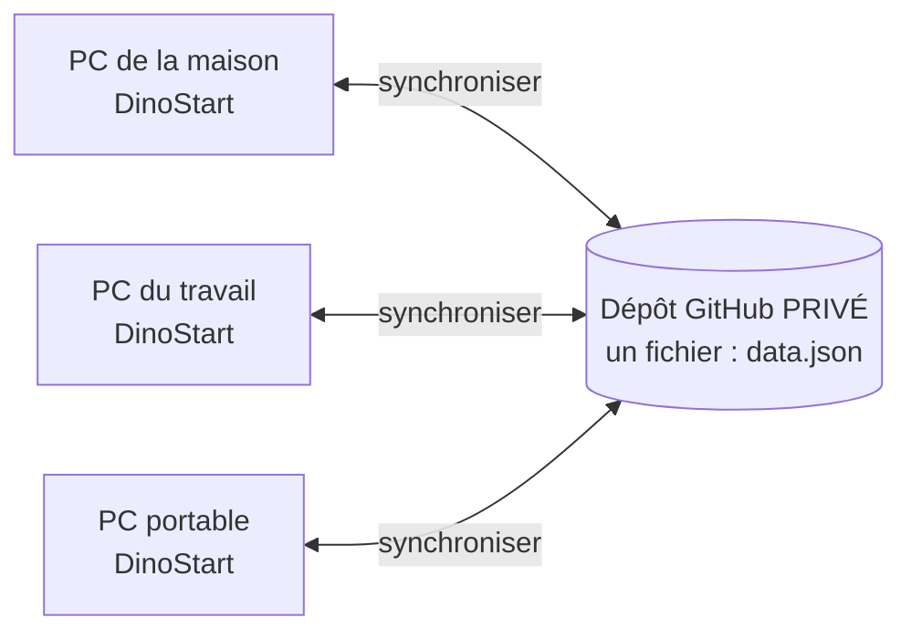

- **Gratuit** : un compte GitHub gratuit suffit. Aucun serveur, aucun abonnement.
- **Privé** : seul toi (et ton jeton) peut lire le dépôt. DinoStart **refuse** de synchroniser vers un dépôt public.
- **Sûr** : DinoStart ne supprime ni n'écrase rien sans te le dire (voir [les conflits](#quand-deux-pc-modifient-la-même-chose)).
- **Sans Internet, ça marche quand même** : tout est enregistré sur ton PC, et la synchro reprend au retour du réseau.

### À faire une seule fois (sur le premier PC)

#### A. Avoir un compte GitHub

Si tu n'en as pas : [github.com/signup](https://github.com/signup) (gratuit).

#### B. Créer ton dépôt privé

1. Va sur **[github.com/new](https://github.com/new)**.
2. **Repository name** : `dinostart-data` (ou ce que tu veux).
3. Choisis **Private** (privé).
4. ✅ **Coche « Add a README file »**. *Important : sans ça, le dépôt n'a pas de branche et la première synchronisation échoue.*
5. Clique sur **Create repository**.

#### C. Créer ton jeton (la « clé » que tu donnes à DinoStart)

Un **jeton** est une clé qui autorise DinoStart à lire et écrire **dans ce seul dépôt**, et nulle part ailleurs.

1. Sur GitHub, clique sur ta **photo** (en haut à droite) → **Settings**.
2. Tout en bas du menu de gauche : **Developer settings**.
3. **Personal access tokens** → **Fine-grained tokens** → **Generate new token**.
4. Remplis :

   | Champ | Valeur |
   |---|---|
   | **Token name** | `DinoStart` (ou `DinoStart PC maison`) |
   | **Expiration** | par exemple **90 days** (note la date pour le renouveler) |
   | **Resource owner** | ton compte |
   | **Repository access** | **Only select repositories** → choisis **uniquement** `dinostart-data` |
   | **Permissions** → *Repository permissions* → **Contents** | **Read and write** |

   Ne touche à **aucune autre** permission (« Metadata : Read-only » s'ajoute tout seul, c'est normal).
5. Clique sur **Generate token**, puis **copie le jeton** : il commence par **`github_pat_`**.

> [!WARNING]
> GitHub **ne te le montrera plus jamais**. Colle-le tout de suite dans DinoStart (étape D). Ne l'envoie à personne, ne le publie nulle part (même pas sur Discord) : c'est comme un mot de passe.
> DinoStart n'accepte que ce type de jeton (ceux qui commencent par `github_pat_`) parce qu'ils peuvent être limités à un seul dépôt. **Ne donne jamais ton mot de passe GitHub.**

#### D. Remplir DinoStart

Dans DinoStart : roue **Paramètres** → onglet **Synchronisation**.

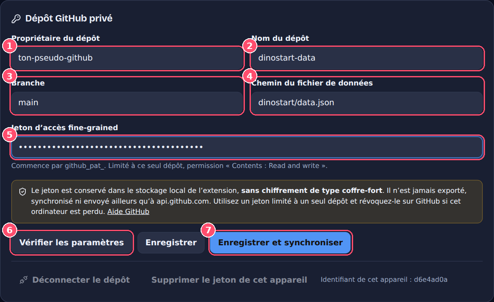

Les valeurs de la capture sont des exemples.

| # | Champ | Que mettre |
|---|---|---|
| **1** | Propriétaire du dépôt | **Ton pseudo GitHub** (exactement comme dans l'adresse de ton dépôt) |
| **2** | Nom du dépôt | `dinostart-data` |
| **3** | Branche | `main` (laisse tel quel) |
| **4** | Chemin du fichier | `dinostart/data.json` (laisse tel quel, il sera créé tout seul) |
| **5** | Jeton | Colle le jeton `github_pat_…` |
| **6** | **Vérifier les paramètres** | Clique d'abord ici : DinoStart teste chaque étape **sans rien enregistrer** |
| **7** | **Enregistrer et synchroniser** | Lance la première synchronisation |

**Vérifier les paramètres** affiche une liste. Tout doit être en **vert** :

- **Paramètres** : les champs sont valides ;
- **Jeton** : le format est bon ;
- **Dépôt** : le dépôt est accessible ;
- **Confidentialité** : « Le dépôt est privé » ;
- **Fichier** : « sera créé à la première synchronisation » (ou, si tu as déjà synchronisé, « Données DinoStart valides »).

Une ligne rouge te dit exactement quoi corriger (voir le [dépannage de la synchro](#dépannage-de-la-synchronisation)).

Clique ensuite sur **Enregistrer et synchroniser**. Si tout va bien, l'indicateur en haut à droite passe à **« Synchronisé »**, et un fichier `dinostart/data.json` apparaît dans ton dépôt GitHub.

#### E. (Conseillé) Activer la synchronisation automatique

Dans le même onglet, active **« Synchronisation automatique »**. Ensuite, DinoStart synchronise tout seul :

- quelques secondes après l'ouverture d'un nouvel onglet ;
- environ **20 secondes après ta dernière modification** (si tu fais dix changements d'affilée, il n'envoie qu'**une seule** fois, jamais à chaque frappe) ;
- et jamais plus d'**une fois par minute**.

> [!NOTE]
> La synchro automatique tourne **tant qu'un onglet DinoStart est ouvert**. Pour récupérer les changements d'un autre PC, il suffit d'ouvrir un nouvel onglet. Tu peux aussi cliquer à tout moment sur **« Synchroniser maintenant »**.

### Ajouter un deuxième (ou troisième) ordinateur

1. Sur l'autre PC : [installe DinoStart](#2-installer-dinostart).
2. Crée **un nouveau jeton pour ce PC** en répétant l'étape **C**.
   *Conseillé : **un jeton par ordinateur**. Si un PC est perdu, tu ne révoques que le sien.*
   Tu peux aussi réutiliser le même jeton, mais il faudra le recopier à la main.
3. **Paramètres → Synchronisation** : saisis **les mêmes** propriétaire, dépôt, branche et chemin, puis **ton jeton**.
4. **Vérifier les paramètres** → **Enregistrer et synchroniser**.
5. Tes favoris, projets, notes, tâches, cartes et réglages **apparaissent**. ✔

> [!NOTE]
> Si le deuxième PC contenait déjà des données, elles sont **fusionnées** avec celles du dépôt : rien n'est perdu.

### Au quotidien

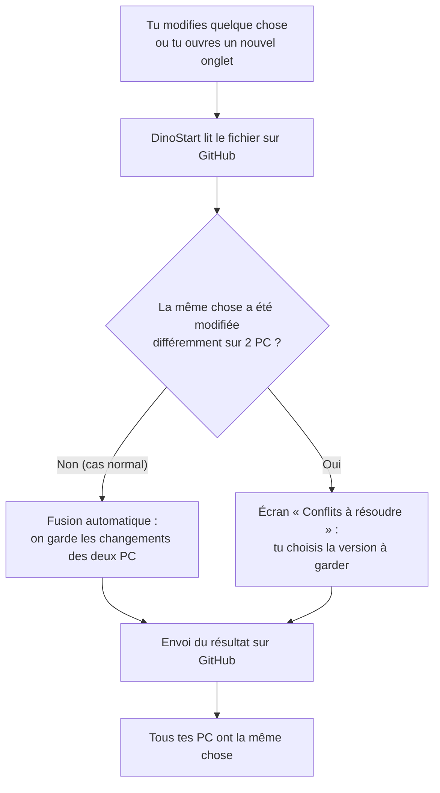

L'indicateur en haut à droite te dit où tu en es :

| Indicateur | Signification |
|---|---|
| **Synchronisé** | Tout est à jour. |
| **En attente** | Tu as des changements pas encore envoyés (ils partent bientôt, ou clique sur *Synchroniser maintenant*). |
| **Synchronisation…** | En cours. |
| **Hors ligne** | Pas de réseau. **Rien n'est perdu**, ça repartira tout seul. |
| **Erreur de synchro** | Clique dessus : le message explique quoi faire. |
| **Conflit à résoudre** | Deux PC ont changé la même chose : tu choisis (voir plus bas). |
| **Limite GitHub** | GitHub demande de patienter quelques minutes : DinoStart attend et réessaie. |
| **Synchro désactivée** | La synchronisation n'est pas configurée sur ce PC. |

### Ce qui est synchronisé… ou pas

| ✅ Synchronisé entre tes PC | 🚫 Reste sur chaque PC |
|---|---|
| Favoris et dossiers | Ton **jeton** GitHub (jamais envoyé, jamais exporté) |
| Projets (liens et chemins compris), notes, tâches | L'**image de fond** |
| La disposition et la taille des cartes | Tes **recherches passées** |
| Thème, couleurs, moteur de recherche, raccourcis | Les **sauvegardes locales** |

### Quand deux PC modifient la même chose

La plupart du temps, il n'y a **aucun souci** : si tu modifies une note sur le PC 1 et un favori sur le PC 2, DinoStart garde **les deux**. Même chose si tu modifies deux champs différents du même élément.

Un **conflit** n'arrive que si, **avant d'avoir synchronisé**, tu changes **exactement la même chose de deux façons différentes** (par exemple tu renommes la même note en « A » sur un PC et en « B » sur l'autre), ou si tu **supprimes** un élément sur un PC pendant que tu le **modifies** sur l'autre.

Dans ce cas, DinoStart **ne choisit pas à ta place** et **n'écrase rien** :

1. Il te montre **« Conflits à résoudre »**, avec les deux versions côte à côte : **« Cet appareil »** et **« GitHub (autre appareil) »**.
2. Tu choisis une version pour chaque élément (ou **« Tout garder ici »** / **« Tout prendre de GitHub »**).
3. Tu cliques sur **« Appliquer mes choix et synchroniser »**.

Une **copie de tes données locales** est automatiquement ajoutée à tes sauvegardes avant tout cela. Les **suppressions** sont synchronisées : un favori supprimé sur un PC ne réapparaît pas sur l'autre.

### Les boutons « avancés »

Dans l'onglet Synchronisation, deux boutons **remplacent** un côté par l'autre. Ils demandent **toujours une confirmation** et te montrent ce qui sera remplacé :

- **Télécharger les données distantes** : ton PC prend **exactement** ce qu'il y a sur GitHub (une sauvegarde locale est faite avant) ;
- **Envoyer les données locales** : GitHub prend **exactement** ce qu'il y a sur ton PC (l'ancienne version reste dans l'historique de GitHub).

Dans 99 % des cas, **« Synchroniser maintenant »** suffit : il fusionne au lieu de remplacer.

### Couper ou changer

- **Déconnecter le dépôt** : ce PC oublie la configuration de synchro. Tes données restent sur le PC et sur GitHub. Le jeton reste enregistré tant que tu ne le supprimes pas.
- **Supprimer le jeton de cet appareil** : retire le jeton de ce PC.
- **Révoquer le jeton côté GitHub** (indispensable si un PC est perdu ou volé) : GitHub → Settings → Developer settings → Personal access tokens → Fine-grained tokens → ouvre `DinoStart` → **Delete**. Il cesse de fonctionner **immédiatement** partout.
- **Jeton expiré** : crée-en un nouveau (étape C) et colle-le dans le champ Jeton, puis **Enregistrer**.

### Dépannage de la synchronisation

| Ce que tu vois | Ce qu'il faut faire |
|---|---|
| « **Jeton refusé ou expiré (401)** » | Le jeton a expiré, a été supprimé ou a été mal copié. Crée-en un nouveau (étape C) et colle-le. |
| « **Accès refusé (403)** » | Le jeton n'a pas **Contents : Read and write** sur ce dépôt. Refais l'étape C en vérifiant les permissions. |
| « **Dépôt introuvable… (404)** » | Faute dans le **pseudo** ou le **nom du dépôt**, ou le jeton n'a pas accès à ce dépôt (GitHub répond « introuvable » dans ce cas). |
| « **La branche … n'existe pas** » | Vérifie le nom de la branche (`main`). Un dépôt créé **sans** README n'a pas de branche : recrée-le en cochant « Add a README file ». |
| « **Ce dépôt est public** » | Passe-le en privé (GitHub → Settings du dépôt → *Danger Zone* → *Change visibility*) ou utilises-en un autre. |
| « **Le fichier distant est refusé…** » | Le fichier `data.json` a été modifié à la main ou vient d'une version plus récente de DinoStart. Il n'est **pas écrasé** : mets DinoStart à jour sur ce PC. |
| « **Limite GitHub atteinte** » | Patiente : DinoStart n'insiste pas et réessaie à l'heure indiquée. |
| « **Le fichier distant a été modifié 3 fois…** » | Un autre PC est en train d'écrire. Réessaie dans un instant : rien n'est perdu. |
| **Hors ligne** alors que tu as Internet | Clique sur **Réessayer** dans Paramètres → Synchronisation. |

### Questions fréquentes

<b>Est-ce vraiment gratuit ?</b>

Oui. Un compte GitHub gratuit et un dépôt privé suffisent. Aucun abonnement, aucun serveur.

<b>Combien d'ordinateurs je peux synchroniser ?</b>

Autant que tu veux : chacun a sa configuration et, idéalement, son propre jeton.

<b>Et sur mon téléphone ?</b>

Non : DinoStart est une extension Chrome pour ordinateur. Chrome sur téléphone n'accepte pas ce type d'extension.

<b>Puis-je utiliser un dépôt que j'ai déjà ?</b>

Oui, mais il doit être <b>privé</b>. Change le « chemin du fichier » pour ne pas écraser un fichier existant (par exemple <code>dinostart/data.json</code> dans un sous-dossier).

<b>Que voit GitHub de mes données ?</b>

Un seul fichier JSON (<code>data.json</code>) dans ton dépôt <b>privé</b> : tes favoris, projets, notes, tâches et réglages. Personne d'autre que toi ne peut le lire. Ton jeton, lui, n'est jamais écrit dedans.

<b>Ça marche sur Edge ou Brave ?</b>

DinoStart est conçu et testé pour Google Chrome. Les navigateurs basés sur Chromium pourraient le charger, mais ce n'est pas testé.

---

## 5. Sauvegarder et restaurer tes données

Clique sur l'icône **Sauvegardes** (la petite boîte, en haut à droite).

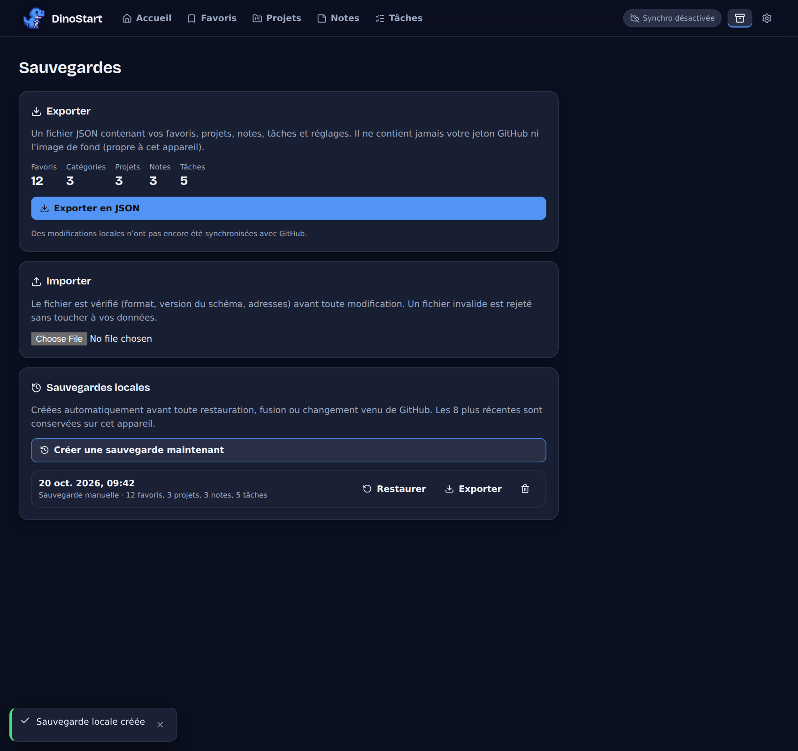

- **Exporter en JSON** : télécharge un fichier avec **tout** (favoris, projets, notes, tâches, cartes, réglages). Il ne contient **jamais** ton jeton ni ton image de fond. **Garde-le en lieu sûr**, il contient tes informations personnelles.
- **Importer** : choisis un fichier. DinoStart le **vérifie d'abord**, te montre ce qu'il contient, puis te propose de **fusionner** avec tes données ou de **tout remplacer**. Un fichier invalide est refusé sans rien modifier.
- **Sauvegardes locales** : DinoStart en crée **automatiquement** avant toute opération risquée (restauration, import, fusion, conflit…). Les 8 dernières sont gardées, tu peux en **restaurer** une en un clic.

> [!TIP]
> Avant de déplacer le dossier de l'extension, de changer de PC ou de réinstaller Chrome : fais un **export** !

---

## 6. Dépannage

| Problème | Solution |
|---|---|
| **Une barre apparaît en bas de la page** (« DinoStart » + « Personnaliser Chrome ») | Elle vient de **Chrome**. **Clic droit dessus → désactive-la.** Si elle revient après une mise à jour de Chrome, refais-le. |
| Le nouvel onglet reste la page de Chrome | Va sur `chrome://extensions` : DinoStart doit être **activé**. Désactive les autres extensions qui changent le nouvel onglet. |
| Mes données ont disparu après avoir déplacé le dossier | Chrome a pris l'extension pour une nouvelle. Remets le dossier à son **ancien emplacement**, ou, si tu as un export : **Sauvegardes → Importer**. |
| Un changement fait dans le dossier n'apparaît pas | Sur `chrome://extensions`, clique sur la flèche **« Actualiser »** de DinoStart. |
| Mes favoris ont un petit **globe** à la place de l'icône | Chrome n'a l'icône que des sites **déjà visités**. Choisis une lettre ou une icône dans la fiche du favori. |
| Pas de **suggestions** pendant que je tape | Elles sont désactivées (Paramètres → Recherche) ou tu es hors ligne. |
| Le bouton **Navigation privée** ne s'ouvre pas | Chrome a refusé (règle de ton organisation par exemple). Utilise `Ctrl + Maj + N`. |
| Les cartes sont **empilées** et ne se déplacent plus | La fenêtre est trop **étroite** (moins de 720 px). Agrandis-la. |
| La **synchronisation** affiche une erreur | Voir le [dépannage de la synchronisation](#dépannage-de-la-synchronisation). |
| Je veux **tout remettre à zéro** | Fais d'abord un export. Puis, dans **Personnaliser**, **« Tout restaurer »** remet les cartes ; pour les données, supprime-les une à une, ou restaure une sauvegarde vide. |

Pour voir les erreurs techniques : touche **F12** sur le nouvel onglet → onglet « Console ». Mets une capture sur [Discord](#8-un-bug-une-idée-une-question-) si besoin.

---

## 7. Vie privée et sécurité

- **Aucune collecte, aucune publicité, aucune télémétrie.** Il n'y a pas de serveur DinoStart.
- **Tes données restent sur ton ordinateur.** Elles ne partent que vers **ton** dépôt GitHub privé, si **tu** actives la synchronisation.
- Seuls **deux sites** peuvent être contactés :
  - `api.github.com` : uniquement pour la synchronisation que tu as configurée ;
  - `suggestqueries.google.com` : uniquement pour les **suggestions de recherche** (désactivables). Aucun cookie ni identifiant n'est envoyé.
- Les **icônes des favoris** viennent de Chrome, sur ton PC : DinoStart ne contacte aucun site pour les récupérer.
- **Permissions demandées à Chrome** : `storage` (garder tes données), `favicon` (les icônes ci-dessus), et l'accès aux deux adresses ci-dessus. **Rien d'autre** : pas ton historique, pas tes onglets, pas le contenu des sites, pas tes cookies.
- **Ton jeton GitHub** est gardé dans le stockage de l'extension, **sans chiffrement de type coffre-fort** : quelqu'un qui accède à ta session Windows et à ton profil Chrome pourrait le lire. C'est pourquoi on le limite à **un seul dépôt privé**, avec **une date d'expiration**, et qu'on le **révoque** en cas de doute.
- Il n'est **jamais** écrit dans le fichier synchronisé, dans les exports, ni dans les messages d'erreur.

---

## 8. Un bug, une idée, une question ?

### 👉 [**Rejoins le Discord de DinoStart**](https://discord.gg/sjvcZ7qsJn)

C'est **là** qu'on suit les problèmes et les idées d'amélioration. Pour qu'on puisse t'aider, écris :

1. **Ce que tu as fait**, étape par étape ;
2. **Ce qui s'est passé** et ce que tu attendais ;
3. une **capture d'écran** si possible ;
4. ta **version de DinoStart** : **Paramètres → Aide** (aussi visible sur `chrome://extensions`).

> [!WARNING]
> **Ne publie jamais** ton jeton GitHub (`github_pat_…`) ni un fichier de sauvegarde exporté : ils contiennent des informations personnelles.

Les idées sont les bienvenues : nouvelle carte, nouveau raccourci, nouvelle option… dis-le sur le Discord !

---

DinoStart · Pour les développeurs : <a href="docs/DEVELOPPEURS.md">documentation technique</a>

